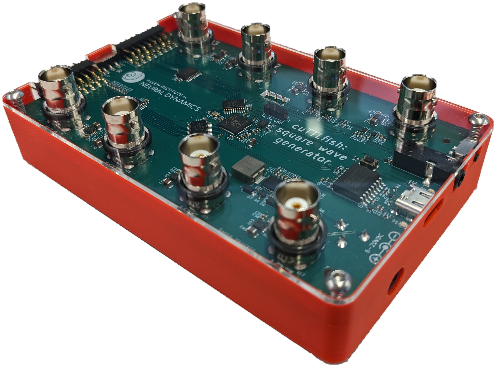
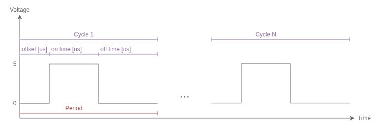

An 8-channel TTL input-or-output device with programmable square wave output

  

## Features
* 8x TTL input or output, configurable.
* Direct PC control of IO Pins:
  * set pins configured as output to either HIGH (5V) or LOW (0V)
  * read the state of pins configured as inputs as either HIGH (~5V) or LOW (~0V) at TTL logic levels.
* Programmable square wave generation with many configurable settings:
  * PWM Frequency range: from 0.01Hz to 2KHz
  * Duty Cycle
  * Offset
  * number of pulses (or infinite)
* Input Capture. Configure pins as inputs to detect
  * rising edges (up to 500Hz)
  * falling edges (up to 500Hz)
  * both! (up to 500hz)
* Harp-protocol compliant (serial num: 0x057B).
* Bonus: "passthrough buffer mode." External 3.3V and 5V CMOS devices can use this device as an octal buffer with external pins.

> [!NOTE]
> This board produces digital outputs and measures digital inputs only! For producing high fidelity _analog_ outputs, refer to the [harp.device.quac](https://github.com/AllenNeuralDynamics/harp.device.quad-dac) device.

## Extra Features
* 6-24VDC input (2.1 x 5.5mm barrel jack, positive center)
* reverse polarity protection
* soft start
* isolated USB to avoid forming ground loops with the PC.

## PWM Waveform Setup
Each IO pin is capable of producing a PWM output. Here are the settings available:
* _offset_us_: how long (in microseconds) the output should remain LOW before switching the output HIGH in one period.
* _on_duration_us_: how long (in microseconds) the output should remain HIGH in one period.
* _off_duration_us_: how long (in microseconds) the output should remain LOW in one period.
* _cycles_: how many pulses to produce or zero for infinite pulses until disabled.
* _invert_: whether the output should be inverted (on-time refers to the output being LOW instead).

> [!NOTE]
> Although multiple PWM channels can be set to different settings and produce outputs concurrently, all PWM outputs must be started at the same time.

> [!NOTE]
> Rising and falling edge events for pins configured with PWM (or analog PWM) settings are produced from the scheduled output changes rather than from monitoring the physical pin. For analog PWM outputs, events reflect the nominal output switching HIGH and LOW rather than every edge of the high-frequency output.

### Analog PWM Outputs
Any IO pin can instead be configured (via the `AnalogPwmSettings0`-`AnalogPwmSettings7` registers) to produce a high-frequency PWM output (i.e: a "virtual analog" output) while the nominal PWM output described above is HIGH.
These registers accept all of the PWM settings above, plus:
* _analog_frequency_hz_: frequency of the high-frequency output (10Hz to 1MHz; 1KHz to 100KHz recommended).
* _analog_duty_cycle_: duty cycle of the high-frequency output (0.0 to 1.0).

The high-frequency output is produced by the RP2040's hardware PWM peripheral and restarts at the beginning of its period every time the nominal output switches HIGH.
Writing to `AnalogPwmSettingsN` replaces any settings previously written to `PwmSettingsN` for that pin (and vice versa).

> [!NOTE]
> Pins 0-1, 2-3, 4-5, and 6-7 each share a hardware PWM peripheral. Analog PWM outputs on the same pair must use the same frequency (but may use different duty cycles). Writing a different frequency to one pin of a pair while the other is configured as an analog PWM output returns an error.
